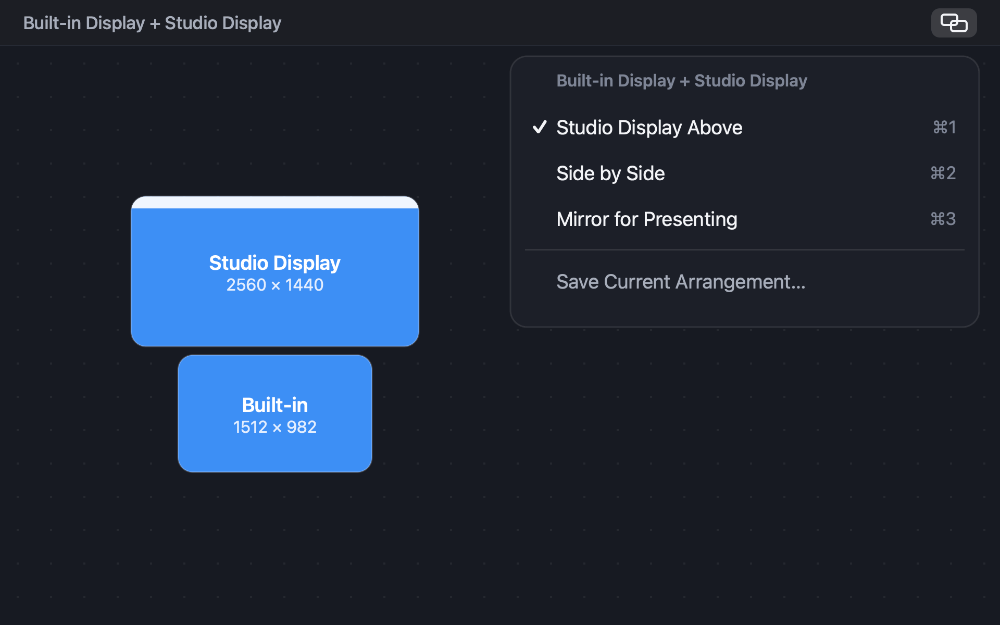
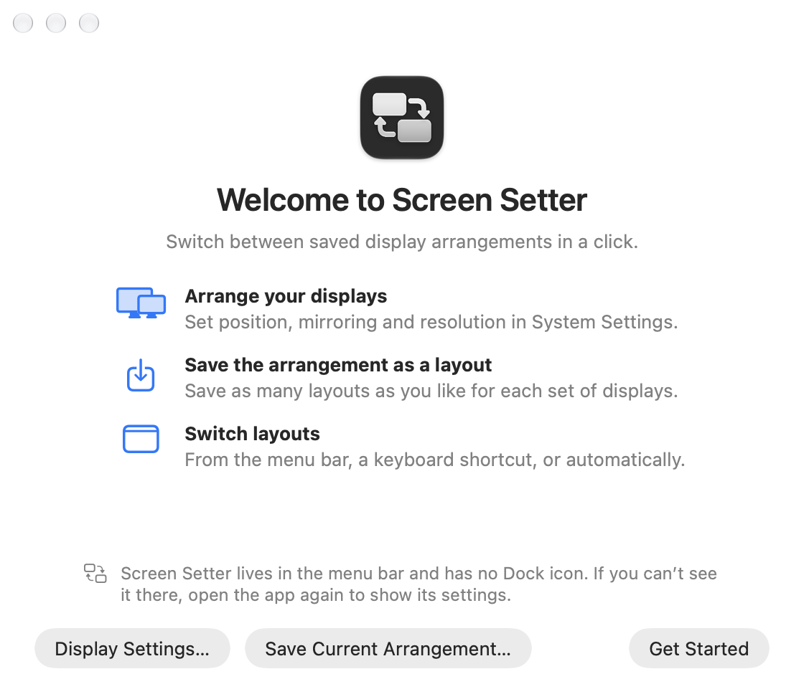

<p align="center">
  
</p>

<h1 align="center">Screen Setter</h1>

<p align="center">
  <b>Your display setups, one click away.</b><br>
  A free menu-bar app for macOS that remembers how your displays are arranged<br>
  and puts each arrangement back with a click, a shortcut, or automatically.
</p>

<p align="center">
  <a href="https://github.com/andrea-lonardo/screen-setter/releases/latest"></a>
  
  
  <a href="LICENSE"></a>
</p>

<p align="center">
  <a href="https://andrea-lonardo.github.io/screen-setter/">Website</a> &nbsp;|&nbsp;
  <a href="#install">Install</a> &nbsp;|&nbsp;
  <a href="#features">Features</a> &nbsp;|&nbsp;
  <a href="SUPPORT.md">Support</a>
</p>

<p align="center">
  
</p>

## Why Screen Setter

Plug into a desk, a projector or a second monitor, and macOS rarely puts things
back the way you had them. Screen Setter saves each arrangement as a **layout**:
which display is where, which one has the menu bar, Extend or Mirror, and each
display's resolution. Switching back takes one click, one shortcut, or nothing at
all.

Layouts are grouped by the exact displays they use, so the menu only ever shows
the ones that fit what's plugged in right now.

## Features

<table>
  <tr>
    <td width="50%" valign="top">
      <h3>One click from the menu bar</h3>
      <p>Pick a layout from the menu. The current one has a checkmark, ⌘1 to ⌘9 choose the first nine while the menu is open, and <b>Undo</b> puts back the arrangement from just before.</p>
    </td>
    <td width="50%" valign="top">
      <h3>A shortcut for every layout</h3>
      <p>Give any layout a global keyboard shortcut, such as <kbd>⌃</kbd><kbd>⌥</kbd><kbd>⌘</kbd><kbd>1</kbd>. It works in every app and needs no Accessibility permission.</p>
    </td>
  </tr>
  <tr>
    <td width="50%" valign="top">
      <h3>Automatic, but careful</h3>
      <p>Choose one layout per set of displays to apply when they connect, when your Mac wakes, or when the app opens. It only acts when the exact same displays are back and their saved resolutions are available, and it never fights a change you just made by hand.</p>
    </td>
    <td width="50%" valign="top">
      <h3>Works with the Shortcuts app</h3>
      <p>Switch from Shortcuts, scripts or launchers with a link like <code>screensetter://apply/Desk</code>. Links can only apply saved layouts; they never change or delete anything.</p>
    </td>
  </tr>
</table>

### Edit a layout without the displays

Drag displays into place, choose Extend or Mirror, the main display and each
resolution, even while they're unplugged. Every edit is checked before it's saved:
one main display, no overlaps, every display touching another.

<p align="center">
  <picture>
    <source media="(prefers-color-scheme: dark)" srcset="docs/images/settings-dark.png">
    
  </picture>
</p>

### Private by design

No accounts, analytics or tracking. Your layouts live in one file on your Mac, and
the only thing the app asks the internet is whether there's a new version, which
you can turn off. See the [Privacy Policy](PRIVACY.md).

## Install

1. Download **Screen Setter.zip** from the
   [latest release](https://github.com/andrea-lonardo/screen-setter/releases/latest)
   and unzip it.
2. Move **Screen Setter** to your Applications folder and open it.
3. The first time, macOS says it can't verify the app. Click **Done**, open
   **System Settings › Privacy & Security**, scroll down, click **Open Anyway**,
   and confirm with **Open**. After that it opens normally.

macOS asks because Screen Setter is free and isn't notarized by Apple, which needs
a paid developer membership. To check your download, compare its checksum with the
SHA-256 on the release page:

```sh
shasum -a 256 ~/Downloads/"Screen Setter.zip"
```

Requires macOS 26 or later, on Apple silicon or Intel. Screen Setter lives in the
menu bar and has no Dock icon; if macOS hides it to make room, open the app again
to show its Settings.

## Quick start

<picture>
  <source media="(prefers-color-scheme: dark)" srcset="docs/images/welcome-dark.png">
  
</picture>

1. Arrange your displays in **System Settings › Displays**.
2. Choose **Save Current Arrangement…** from the Screen Setter menu and give it a
   name, such as "Studio Display Above".
3. Rearrange your displays and save another layout, if you like.
4. Pick any layout from the menu to switch to it.

Turn on **Open at Login** in Settings to start Screen Setter with your Mac.

<br clear="right">

## More details

<details>
<summary><b>Layouts and display sets</b></summary>

A layout belongs to the exact set of displays it was saved with, for example
"Built-in Display + Studio Display". Display sets are created for you when you save
a layout for new hardware, and disappear when their last layout is deleted. The
menu shows the set that is connected now; Settings shows all of them.

In Settings you can rename and reorder layouts, duplicate or delete them, and rename
and reorder display sets. A set without a custom name is named after its displays.
**Replace with Current Arrangement** updates a layout from how the displays are
arranged now. Rotation is saved and preserved, but changing it needs **System
Settings › Displays**.
</details>

<details>
<summary><b>Keyboard shortcuts</b></summary>

Shortcuts are set in each layout's editor. A shortcut for a layout whose displays
aren't connected tells you to connect them instead of changing anything. Each
shortcut belongs to one layout; assigning it to another layout moves it. If another
app already uses a shortcut, macOS won't let Screen Setter register it, and the menu
shows **Review Keyboard Shortcuts…** so you can choose another.
</details>

<details>
<summary><b>Automatic layouts</b></summary>

Automatic layouts are off by default. They wait a moment after a display change,
need an exact match of displays, and only apply when the saved resolutions and
mirroring are still available. If something changed, nothing is applied and the
menu shows **Review Display Layout…** with the reason. Don't use another display
manager that enforces a different arrangement on the same displays.
</details>

<details>
<summary><b>Shortcuts app and URLs</b></summary>

Use an **Open URLs** action in the Shortcuts app, or any launcher that opens URLs:

```text
screensetter://apply/Studio%20Display%20Above
screensetter://apply/<layout identifier>
screensetter://settings
```

`apply` accepts a layout's name (not case-sensitive; spaces and other special
characters are percent-encoded), its identifier, or a 1.x preset ID such as
`ipad-left`. If two layouts share a name, rename one or use the identifier. URLs
only apply saved layouts; they can't save, change, or delete anything, and they
never run commands or scripts. Open Screen Setter once normally so macOS registers
its URL scheme. Links that use the old `displaylayouts://` scheme work the same way.
</details>

<details>
<summary><b>How it changes displays</b></summary>

Screen Setter uses Core Graphics to change the whole arrangement in one
transaction. Before changing anything, it checks that exactly the saved displays
are connected and that every saved mode is still available. Applying the layout that
is already active does nothing. Afterwards it checks the result for up to two
seconds and tells you if macOS didn't apply everything.

Sidecar connections, turning displays off, HDR and color settings, rotation, and
window positions are outside what it does.
</details>

<details>
<summary><b>Your data and updates</b></summary>

Layouts are stored in `~/Library/Application Support/Screen Setter/library.json`,
with the previous version kept beside it as `library.previous.json`. If the file
can't be read, it is set aside as a backup rather than overwritten, and Screen
Setter tells you at launch.

Screen Setter updates itself with [Sparkle](https://sparkle-project.org). The
second time it opens, it asks whether to check for updates automatically; you can
change that in **Settings › General › Updates** or use **Check for Updates…** in the
menu. Updates are signed, and Screen Setter verifies the signature before installing
one.
</details>

<details>
<summary><b>Uninstall</b></summary>

Turn off **Open at Login** if you use it, quit Screen Setter from its menu, and move
the app to the Trash. To remove your layouts too, delete:

```text
~/Library/Application Support/Screen Setter/
~/Library/Preferences/io.github.andrea-lonardo.screen-setter.plist
```
</details>

<details>
<summary><b>Coming from Display Layouts</b></summary>

Screen Setter was called Display Layouts until version 2.0. The first time it
opens, it copies your saved layouts from `~/Library/Application Support/Display
Layouts/` into its own folder. The old folder is read but never changed.

Your five 1.x presets (iPad Left, iPad Right, Monitor Above, Monitor Right, and
Projector Mirror) become ordinary layouts. Old `displaylayouts://apply/ipad-left`
links keep working. Presets saved by very old versions as `.command` files are
imported when their displays are next connected; they are read as data and never
executed.

2.0 has a new name and bundle identifier, so turn on **Open at Login** again in
Settings and remove the old Display Layouts login item in **System Settings ›
General › Login Items & Extensions** if it's still listed.
</details>

## Build from source

<details>
<summary><b>Requirements, build and test</b></summary>

Requires macOS 26 or later and Xcode 26 or later with the macOS 27 SDK. The
Command Line Tools alone aren't enough: the icon is compiled with Xcode's `actool`.
There is no Xcode project; the app is built with `swiftc`.

```sh
./build.sh
sh Tests/run.sh
"build/Screen Setter.app/Contents/MacOS/Screen Setter" --diagnose
```

`build.sh` produces an ad-hoc signed universal `build/Screen Setter.app`,
`build/Screen Setter.zip`, and its SHA-256 checksum. It doesn't install or publish
anything. `--diagnose` prints the connected displays without changing anything or
reading your saved layouts. The tests use temporary files and a fake display
engine, so they never rearrange your screens.

To try the interface with sample data that can't touch your real displays or
layouts:

```sh
open -n "build/Screen Setter.app" --args --preview-settings
open -n "build/Screen Setter.app" --args --preview-onboarding
"build/Screen Setter.app/Contents/MacOS/Screen Setter" --render-settings /tmp/settings.png --dark
"build/Screen Setter.app/Contents/MacOS/Screen Setter" --render-onboarding /tmp/welcome.png
```

The website in `docs/` is static HTML. Its Privacy, Terms and Support pages are
generated from `PRIVACY.md`, `TERMS.md` and `SUPPORT.md`, and the README animation
is drawn by a script:

```sh
python3 Tools/build_site_pages.py
swift Tools/make_demo_gif.swift docs/images/demo.gif
```
</details>

<details>
<summary><b>Source layout</b></summary>

```text
Sources/ScreenSetter/main.swift                Entry point, URL scheme, command-line tools
Sources/ScreenSetter/AppModel.swift            Shared app state and operation serialization
Sources/ScreenSetter/MenuBarController.swift   Menu bar item and menu
Sources/ScreenSetter/HotkeyCenter.swift        Global keyboard shortcuts
Sources/ScreenSetter/UpdateController.swift    Sparkle update checks
Sources/ScreenSetter/Settings/                 Settings, layout editor, and onboarding windows
Sources/ScreenSetter/LayoutStore.swift         Layout library operations and Undo
Sources/ScreenSetter/Library.swift             Layout, display set, and shortcut types
Sources/ScreenSetter/LibraryRepository.swift   library.json storage and 1.x migration
Sources/ScreenSetter/DisplayEngine.swift       Core Graphics capture, preflight, apply
Sources/ScreenSetter/PreviewSupport.swift      Sample data for previews
Tests/                                         Isolated regression suite
Resources/                                     Bundle metadata and app icon
Vendor/Sparkle/                                Sparkle 2.10.1 framework and license
Tools/                                         Icon, website page, and demo helpers
docs/                                          Website, published with GitHub Pages
DESIGN.md                                      Website design system
```
</details>

See [CHANGELOG.md](CHANGELOG.md) for what's new.

## Support

See [SUPPORT.md](SUPPORT.md) for common fixes. Report bugs and ask questions in
[GitHub Issues](https://github.com/andrea-lonardo/screen-setter/issues), and report
security problems privately as described in [SECURITY.md](SECURITY.md).

## License

Screen Setter is free and open source under the [MIT License](LICENSE). It includes
[Sparkle](https://sparkle-project.org), also under the MIT License
([Vendor/Sparkle/LICENSE](Vendor/Sparkle/LICENSE)). Screen Setter is provided as
is, without warranty of any kind. See the [Terms of Use](TERMS.md) and the
[Privacy Policy](PRIVACY.md).

Mac and macOS are trademarks of Apple Inc., registered in the U.S. and other
countries and regions. Screen Setter is not affiliated with or endorsed by Apple.
