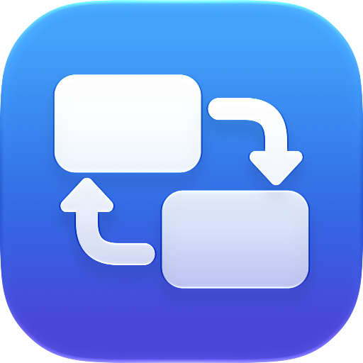
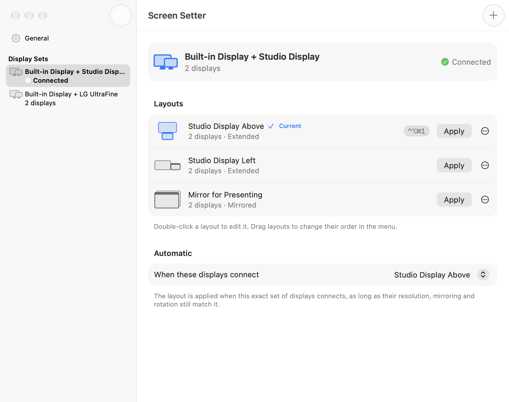

<p align="center">
  
</p>

# Screen Setter

Your display setups, one click away. A small, free menu-bar app for macOS that
remembers how your displays are arranged — side by side, stacked, or mirrored — and
puts each arrangement back with a click, a keyboard shortcut, or automatically when
the displays connect.

Save as many layouts as you like. Each one is a snapshot of the current arrangement:
which display is where, which is the main display, Extend or Mirror, and each
display's resolution. Screen Setter groups them by the displays they use, so the
menu only ever shows layouts that fit what is plugged in right now.

Website: [andrea-lonardo.github.io/screen-setter](https://andrea-lonardo.github.io/screen-setter/)

**Version 2.0 (21), in development.** Requires macOS 26 or later, on Apple silicon
or Intel.

<p align="center">
  
</p>

## Install

1. Download `Screen Setter.zip` from the
   [latest release](https://github.com/andrea-lonardo/screen-setter/releases/latest)
   and unzip it.
2. Move **Screen Setter** to your Applications folder.
3. Open it. The first time, macOS says it can't verify the app and won't open it.
   Click **Done**, then open **System Settings › Privacy & Security**, scroll down,
   click **Open Anyway**, and confirm with **Open**. After that it opens normally.

macOS asks because Screen Setter is free and isn't notarized by Apple, which needs
a paid Apple developer membership. To check that your download is the published
one, compare its checksum with the SHA-256 listed on the release page:

```sh
shasum -a 256 ~/Downloads/"Screen Setter.zip"
```

Screen Setter lives in the menu bar and has no Dock icon. If macOS hides it to
make room in the menu bar, open the app again to show its Settings. To start it
with your Mac, turn on **Open at Login** in its Settings.

## Quick start

1. Connect your displays and arrange them in **System Settings › Displays**.
2. Choose **Save Current Arrangement…** from the Screen Setter menu and give it a
   name, such as "Studio Display Above".
3. Rearrange your displays and save another layout, if you like.
4. Choose any saved layout from the menu to switch to it. The current layout has a
   checkmark. While the menu is open, Command-1 through Command-9 choose the first
   nine layouts.

**Undo** in the menu (Command-Z) puts back the arrangement from just before the last
display change, as long as the same displays are still connected.

## Layouts and display sets

A layout belongs to the exact set of displays it was saved with — for example
"Built-in Display + Studio Display". Display sets are created for you when you save
a layout for new hardware, and disappear when their last layout is deleted. The
menu shows the set that is connected now; Settings shows all of them.

In Settings you can rename and reorder layouts, duplicate or delete them, and rename
and reorder display sets. A set without a custom name is named after its displays.
**Replace with Current Arrangement** updates a layout from how the displays are
arranged now.

## Editing a layout

You don't need the displays connected to edit a layout. The editor lets you:

- drag displays to change their positions;
- choose **Extend** or **Mirror**, and which display is the main display;
- pick each display's resolution from the modes it offered when the layout was saved.

Screen Setter checks that the arrangement is valid (one main display, no overlaps,
every display touching another) before saving. If the display set is connected, you
can apply the edited layout straight away.

Rotation is saved and preserved, but changing it needs **System Settings ›
Displays**.

## Keyboard shortcuts

Give any layout a global keyboard shortcut in Settings, such as Control-Option-
Command-1. Shortcuts work from any app and don't need Accessibility permission. A
shortcut for a layout whose displays aren't connected tells you to connect them
instead of changing anything. Each shortcut belongs to one layout; assigning it to
another layout moves it.

If another app already uses a shortcut, macOS won't let Screen Setter register
it. The menu then shows **Review Keyboard Shortcuts…** so you can choose another.

## Automatic layouts

For each display set you can choose one layout to apply automatically when those
displays connect, when your Mac wakes, and when Screen Setter opens. It is off by
default.

Automatic layouts are deliberately cautious. They wait a moment after a display
change, need an exact match of displays, and only apply when the saved resolutions
and mirroring are still available. If something changed, nothing is applied and the
menu shows **Review Display Layout…** with the reason. If you rearrange displays by
hand afterwards, Screen Setter doesn't fight you by forcing the automatic layout
back.

Don't use another display manager that enforces a different arrangement on the
same displays.

## Shortcuts app and URLs

Use an **Open URLs** action in the Shortcuts app, or any launcher that opens URLs:

```text
screensetter://apply/Studio%20Display%20Above
screensetter://apply/<layout identifier>
screensetter://settings
```

`apply` accepts a layout's name (not case-sensitive; spaces and other special
characters are percent-encoded), its identifier, or a 1.x preset ID such as
`ipad-left`. If two layouts share a name, rename one or use the identifier. The
displays must be connected. URLs only apply saved layouts — they can't save,
change, or delete anything, and they never run commands or scripts.

Open Screen Setter once normally so macOS registers its URL scheme. Links that use
the old `displaylayouts://` scheme work the same way.

## How it changes displays

Screen Setter uses Core Graphics to change the whole arrangement in one
transaction. Before changing anything, it checks that exactly the saved displays
are connected and that every saved mode is still available. Applying the layout that
is already active does nothing. Afterwards it checks the result for up to two
seconds and tells you if macOS didn't apply everything, rather than pretending it
worked.

Sidecar connections, turning displays off, HDR and color settings, rotation, and
window positions are outside its scope.

## Your data

Layouts are stored in a single file:

```text
~/Library/Application Support/Screen Setter/library.json
```

The previous version of the file is kept beside it as `library.previous.json`.
If the file can't be read, it is set aside as a backup rather than overwritten,
and Screen Setter tells you at launch. There are no accounts, telemetry, cloud
services, or network requests. See the [Privacy Policy](PRIVACY.md).

## Uninstall

Quit Screen Setter from its menu, turn off **Open at Login** first if you use it,
and move the app to the Trash. To remove your layouts too, delete:

```text
~/Library/Application Support/Screen Setter/
~/Library/Preferences/io.github.andrea-lonardo.screen-setter.plist
```

## Coming from Display Layouts

Screen Setter was called Display Layouts until version 2.0. The first time it
opens, it copies your saved layouts from `~/Library/Application Support/Display
Layouts/` into its own folder. The old folder is read but never changed.

Your five 1.x presets (iPad Left, iPad Right, Monitor Above, Monitor Right, and
Projector Mirror) become ordinary layouts the first time 2.0 opens. Old
`displaylayouts://apply/ipad-left`-style URLs keep working. Presets saved by very
old versions as `.command` files are imported when their displays are next
connected; they are read as data and never executed. The original files in
`Profiles/` are left untouched.

2.0 has a new name and bundle identifier, so turn on **Open at Login** again in
Settings and remove the old Display Layouts login item in **System Settings ›
General › Login Items & Extensions** if it's still listed.

## Build from source

Requires macOS 26 or later and Xcode 26 or later with the macOS 27 SDK. The
Command Line Tools alone aren't enough: the icon is compiled with Xcode's `actool`.
There is no Xcode project; the app is built with `swiftc`.

```sh
./build.sh
sh Tests/run.sh
"build/Screen Setter.app/Contents/MacOS/Screen Setter" --diagnose
```

`build.sh` produces an ad-hoc signed universal (Apple silicon and Intel)
`build/Screen Setter.app`, `build/Screen Setter.zip`, and its SHA-256 checksum. It
doesn't install or publish anything.

`--diagnose` prints the connected displays, their modes, and mirroring without
changing anything or reading your saved layouts. The tests use temporary files and
a fake display engine, so they never rearrange your screens.

To try the interface with sample data that can't touch your real displays or
layouts:

```sh
open -n "build/Screen Setter.app" --args --preview-settings
open -n "build/Screen Setter.app" --args --preview-onboarding
"build/Screen Setter.app/Contents/MacOS/Screen Setter" --render-settings /tmp/settings.png --dark
"build/Screen Setter.app/Contents/MacOS/Screen Setter" --render-onboarding /tmp/welcome.png
```

The website in `docs/` is static HTML. Its Privacy, Terms and Support pages are
generated from `PRIVACY.md`, `TERMS.md` and `SUPPORT.md`; regenerate them after
editing those files:

```sh
python3 Tools/build_site_pages.py
```

## Source layout

```text
Sources/ScreenSetter/main.swift                Entry point, URL scheme, command-line tools
Sources/ScreenSetter/AppModel.swift            Shared app state and operation serialization
Sources/ScreenSetter/MenuBarController.swift   Menu bar item and menu
Sources/ScreenSetter/HotkeyCenter.swift        Global keyboard shortcuts
Sources/ScreenSetter/Settings/                 Settings, layout editor, and onboarding windows
Sources/ScreenSetter/LayoutStore.swift         Layout library operations and Undo
Sources/ScreenSetter/Library.swift             Layout, display set, and shortcut types
Sources/ScreenSetter/LibraryRepository.swift   library.json storage and 1.x migration
Sources/ScreenSetter/DisplayEngine.swift       Core Graphics capture, preflight, apply
Sources/ScreenSetter/PreviewSupport.swift      Sample data for previews
Tests/                                         Isolated regression suite
Resources/                                     Bundle metadata and app icon
Tools/                                         Icon export and website page helpers
docs/                                          Website, published with GitHub Pages
DESIGN.md                                      Website design system
```

See [CHANGELOG.md](CHANGELOG.md) for changes and previous releases.

## Support

See [SUPPORT.md](SUPPORT.md) for common fixes. Report bugs and ask questions in
[GitHub Issues](https://github.com/andrea-lonardo/screen-setter/issues). Report
security problems privately as described in [SECURITY.md](SECURITY.md).

## License

Screen Setter is free and open source under the [MIT License](LICENSE). It is
provided as is, without warranty of any kind. See the [Terms of Use](TERMS.md) and
the [Privacy Policy](PRIVACY.md): the app collects no data.

Mac and macOS are trademarks of Apple Inc., registered in the U.S. and other
countries and regions. Screen Setter is not affiliated with or endorsed by Apple.
